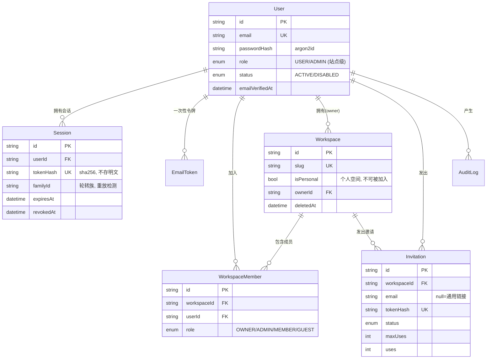

# 数据库设计（M1）

> 对应文件：`apps/api/prisma/schema.prisma`
> 迁移命令：`pnpm --filter @notecloud/api exec prisma migrate dev --name init`
> 本文档说明**为什么这么建表**，字段细节以 schema 为准。

---

## 1. 全局约定

| 约定 | 取值 | 理由 |
|---|---|---|
| 主键 | `String @id @default(cuid())` | 自增 ID 会泄漏业务规模；cuid 有序、无碰撞、URL 友好 |
| 时间 | 全部 UTC，服务端 `default-time-zone=+00:00` | 跨时区团队不会因为服务器搬迁而错乱；展示时区由前端按 `users.timezone` 转换 |
| 软删除 | 业务实体带 `deletedAt DateTime?` | 回收站、同步墓碑都依赖它；**所有查询必须显式带 `deletedAt: null`** |
| 乐观锁 | 需防并发覆盖的实体带 `version Int` | 团队协作下"后写覆盖"会丢数据，冲突必须显式暴露（M2 笔记已启用） |
| 表名 | snake_case（`@@map`） | MySQL 惯用法，且避免大小写敏感导致跨平台迁移失败 |
| 字符集 | `utf8mb4` | emoji 与中文都安全 |

> **注意排序规则的实际值**：数据库默认是 `utf8mb4_0900_ai_ci`，但 **Prisma 建表时会显式写到
> `utf8mb4_unicode_ci`**（Prisma 的默认行为，schema 里没有开关）。所以 `notecloud` 库里的表实际是
> `utf8mb4_unicode_ci`，而库默认是 `0900_ai_ci`。
> 这不影响使用（所有表一致、字面量会自动向列的排序规则靠拢），但**不要**在文档或 SQL 里假设两者相同。

**⚠️ 软删除与唯一索引的坑**：MySQL 的唯一索引把 `NULL` 视为互不相等，所以
`UNIQUE(workspaceId, name)` 在软删除场景下**不会**拦住"回收站里已有同名记录时再建一个同名"。
`notes` 没有需要唯一约束的字段，`tags` 用的是硬删除（标签删除即解关联），所以暂时不受影响；
将来给 `notebooks` 加同名约束时，要么把 `deletedAt` 放进唯一键，要么完全交给应用层校验。
`users.email` 是硬唯一（账户不允许软删后复用同一邮箱），不受此影响。

---

## 2. M1 实体关系



---

## 3. 表说明

### 3.1 `users`

| 字段 | 说明 |
|---|---|
| `email` | 唯一，硬约束（不做软删）。存原样还是小写？**统一存小写**，由应用层 `normalizeEmail()` 处理 |
| `passwordHash` | argon2id，长度留 255 |
| `role` | **站点级**角色，只用于管理员后台，与工作区角色无关。首个注册用户自动为 `ADMIN` |
| `status` | `DISABLED` 的用户不能登录，但数据保留（成员仍显示为"已停用"） |
| `emailVerifiedAt` | 当前邀请制阶段可为空；启用 SMTP + 邮箱验证后使用 |
| `timezone` | 默认 `Asia/Shanghai`，用于**展示**时间，不影响存储 |

索引：`email`(unique)、`status`、`role`。

### 3.2 `sessions` — Refresh Token 轮转与重放检测

这是安全设计的核心，不是简单的"存个 token"：

1. 登录 → 生成 refresh token（随机 32 字节），**只把 sha256 存库**，明文只回给客户端（httpOnly cookie）
2. 刷新时 → 旧 token 标记 `revokedAt` + `replacedById` 指向新会话，发新 token（同一 `familyId`）
3. **重放检测** → 如果一个**已被撤销**的 token 又被使用，说明 token 泄漏了 → **吊销整个 `familyId`**，强制重新登录

索引：`tokenHash`(unique)、`(userId, revokedAt)`、`familyId`、`expiresAt`（清理过期会话用）。

### 3.3 `workspaces`

| 字段 | 说明 |
|---|---|
| `slug` | 唯一，用于 URL（`/w/acme`）。从 name 生成，冲突时加后缀 |
| `isPersonal` | 每个用户注册时自动创建一个个人工作区；**不允许被加入、不允许被删除**，保证用户永远有一个落脚点 |
| `ownerId` | 工作区创建者。与 `WorkspaceMember.role = OWNER` 冗余，但**以成员表的角色为准**，`ownerId` 仅用于快速查询与转让 |
| `deletedAt` | 软删除。删除工作区是重操作，需要二次确认 + 审计 |

> 冗余说明：`ownerId` 和 `WorkspaceMember(role=OWNER)` 是双写。为什么要冗余？因为"查我拥有的工作区"是高频操作，
> 走成员表需要 join + 过滤。**写路径必须在一个事务里同时维护两者**，转让所有权同理。

### 3.4 `workspace_members` — 权限的唯一事实来源

- `@@unique([workspaceId, userId])`：一个用户在一个工作区只有一条记录
- `role` 四级：`OWNER > ADMIN > MEMBER > GUEST`
- **不变量**：**任何时刻每个工作区至少有一个 `OWNER`**
  - 移除成员 / 降级 / 退出 → 如果是最后一个 owner，返回 `40902 LAST_OWNER`
  - 转让所有权 = 事务内「新 owner 升为 OWNER」+「老 owner 降为 ADMIN」
- `invitedById` 记录是谁拉进来的，方便追溯

### 3.5 `invitations` — 邀请制注册的载体

设计上**一个模型覆盖两种邀请**：

| 形态 | `email` | 用途 |
|---|---|---|
| 通用邀请链接 | `NULL` | 生成一个链接，谁拿到谁能用（受 `maxUses` 限制）。**当前阶段主要用这个**，不依赖 SMTP |
| 指定邮箱邀请 | 有值 | 只有该邮箱能接受。等 SMTP 配好后启用 |

- `tokenHash` 只存 sha256，明文只出现在邀请链接里
- `status` 由 `expiresAt` / `uses >= maxUses` 推导，但有显式字段便于查询与撤销
- 接受邀请：`uses += 1`，`uses >= maxUses` 时置 `ACCEPTED`

### 3.6 `site_settings` — 站点配置

`key` + `Json value` 的 KV 表。首次启动引导写入：

| key | 示例值 | 说明 |
|---|---|---|
| `registration.enabled` | `false` | 是否开放公开注册（**当前为 false，邀请制**） |
| `registration.requireEmailVerification` | `false` | 启用 SMTP 后改 true |
| `site.name` | `"NoteCloud"` | 站点名 |
| `mail.enabled` | `false` | SMTP 是否配置完成 |

> 为什么用 KV 表而不是配置文件？因为管理员要在后台改，且更改需要审计。但**敏感项（JWT_SECRET、数据库密码、SMTP 密码）
> 永远只放 `.env`，绝不入库**——这是自部署产品的安全底线。

### 3.7 `audit_logs`

- `actorId` 用 `onDelete: SetNull`：用户被删除后日志仍要保留（否则审计链断掉）
- `meta Json` 存变更前后差异
- `workspaceId` 冗余存储，方便按工作区查活动流（M7 的通知/活动流会复用）

---

## 4. 权限矩阵 → 数据模型映射

权限判定**只在服务层一处实现**，路由只声明"需要什么角色"。

| 操作 | OWNER | ADMIN | MEMBER | GUEST |
|---|:---:|:---:|:---:|:---:|
| 查看工作区 | ✅ | ✅ | ✅ | ✅ |
| 修改工作区信息 | ✅ | ✅ | ❌ | ❌ |
| 删除工作区 | ✅ | ❌ | ❌ | ❌ |
| 查看成员列表 | ✅ | ✅ | ✅ | ❌ |
| 邀请成员 | ✅ | ✅ | ❌ | ❌ |
| 修改成员角色 | ✅ | ✅（不能动 OWNER） | ❌ | ❌ |
| 移除成员 | ✅ | ✅（不能动 OWNER） | ❌ | ❌ |
| 退出工作区 | ✅（需先转让） | ✅ | ✅ | ✅ |
| 转让所有权 | ✅ | ❌ | ❌ | ❌ |

判定流程（`plugins/workspace.ts`）：

```
请求 → 解析 :workspaceId → 查 workspace_members(workspaceId, userId, workspace.deletedAt=null)
     → 不在成员表 → 40301 NOT_MEMBER
     → 在，但角色不满足 → 40302 INSUFFICIENT_ROLE
     → 通过，把 { workspace, member, role } 挂到 request.ctx
```

> **关键纪律**：`workspaceId` 必须来自路由参数并被校验，**永远不要相信请求体里传的 workspaceId**。
> 所有工作区资源的查询都强制带 `workspaceId` 条件，这是防越权的唯一可靠手段。

---

## 5. M2：笔记 / 笔记本 / 标签（已实现）

迁移文件：`prisma/migrations/20261017061415_notes`

| 表 | 说明 |
|---|---|
| `notebooks` | 树形结构。`parentId` 自引用 + `position` 排序 + `depth`（限 5 层）。软删除 |
| `notes` | `title` / `content`(LONGTEXT) / `excerpt` / `visibility` / `version` 乐观锁 / `deletedAt` |
| `note_notebooks` | 笔记 ↔ 笔记本 **多对多**（已确认：一条笔记可属于多个笔记本） |
| `tags` / `note_tags` | 工作区级标签，多对多，`UNIQUE(workspaceId, name)` |

### 5.1 三个必须记住的行为

**① 删除笔记本 = 只解关联，不删笔记**
`deleteNotebook` 会先物理删除该笔记本（含全部子孙）的 `note_notebooks` 记录，再软删笔记本。
为什么必须物理删关联？因为"收件箱"的定义是 `notebooks: { none: {} }` —— 如果关联还挂着已删除的笔记本，
笔记会既不在收件箱、也找不到归属，直接从所有视图里消失。`pnpm smoke` 里有专门的断言守着这条。

**② 笔记加入回收站 = 软删，30 天后物理删除**
`deletedAt` 非空即进入回收站。保留期常量在 `packages/shared` 的 `TRASH_RETENTION_DAYS = 30`，
前端用它算"剩余天数"。到期清理要靠定时任务（尚未实现，见 §8 待办）。

**③ 乐观锁走的是原子 CAS，不是"先查后写"**
```ts
prisma.note.updateMany({
  where: { id, version: input.version, ... },   // 版本作为 WHERE 条件
  data: { ..., version: { increment: 1 } },
})
```
命中 0 行即代表版本已被别人推进 → 返回 `40900` + **服务端最新内容**，前端弹「用服务端版本 / 用我的覆盖」。
绝不静默覆盖。

### 5.2 可见性

`notes.visibility`：`PRIVATE`（仅创建者）/ `WORKSPACE`（工作区成员，默认）。
所有读取笔记的查询都必须带上这条过滤：

```ts
{ OR: [{ visibility: 'WORKSPACE' }, { createdById: userId }] }
```

漏掉任何一处就是越权泄漏，所以它被收进 `modules/notes/service.ts` 的 `visibilityFilter()` 单点维护。

---

## 6. M3：待办任务 / 子任务 / 评论（已实现）

迁移文件：`prisma/migrations/20261017064511_tasks`

| 表 | 说明 |
|---|---|
| `tasks` | 状态 / 优先级 / 起止时间 / 负责人 / `position` / `version` 乐观锁 / `deletedAt` |
| `task_checklists` | 子任务清单，**只做一层**（嵌套收益远小于复杂度） |
| `task_tags` | 任务 ↔ 标签，与笔记**共用同一套 `tags` 表** |
| `comments` | 多态目标（`targetType` + `targetId`），M3 只用于任务 |

### 6.1 没有 Project 层（已确认）

任务的分组只有三种：**状态**、**标签**、**截止时间**。
不建 `projects` 表 —— 因为 M4 的看板列就是任务状态，再叠一层"项目"会变成两套并行的分组概念，
用户和代码都要反复判断"这个任务到底在哪一层"。

M4 会给 `tasks` 加 `boardId` / `columnId`，列直接映射 `status`，不另建卡片表。

### 6.2 「今天 / 本周」与时区

库里存 UTC，但用户说的"今天"是**他本地的今天**。所以 `listTasks` 接收 `timeZone`（取 `users.timezone`），
用 `Intl.DateTimeFormat` 求出偏移再算当天 00:00 的 UTC 时刻（`startOfDayInTz`）。
中国无夏令时，简单平移足够；有 DST 的时区在切换当天可能差一小时，对"今天"这个粒度可以接受。

### 6.3 状态变更会写时间戳

| 变成 | 效果 |
|---|---|
| `DONE` | `completedAt = now`，`canceledAt = null` |
| `CANCELED` | `canceledAt = now`，`completedAt = null` |
| `TODO` / `IN_PROGRESS` | 两个时间戳都清空 |

所以"已完成"视图按 `status = DONE` 过滤即可，不需要再判断 `completedAt`。

### 6.4 评论为什么是多态表

`comments` 用 `targetType + targetId` 而不是 `taskId` 外键，是为了 M5 给笔记加评论时不用再来一次迁移。
代价是**没有外键约束**：任务被硬删除时必须手动清评论（`purgeTask` 与定时清理都已处理），
否则会留下永远看不到也删不掉的孤儿行。

### 6.5 子任务勾选不带乐观锁

`PATCH /tasks/:id/checklist/:itemId` 只改一个布尔值，**不校验 `version`**。
理由：勾一个复选框因为别人改了标题而失败，体验上说不通。整体覆盖子任务列表时才走乐观锁。

---

## 7. M4：看板（已实现）

迁移文件：`prisma/migrations/20261017150049_boards`（**手工落盘**，原因见下）

| 表 | 说明 |
|---|---|
| `boards` | 工作区下的看板，软删除 |
| `board_columns` | 列。`status` 字段决定"拖进这一列的任务是什么状态"，另有 `position` / `color` / `wipLimit` |
| `tasks.columnId` | 新增的可空外键（`ON DELETE SET NULL`）。**卡片就是任务，没有 cards 表** |

### 7.1 为什么这次迁移是手工写的

`prisma migrate dev` 在检测到 drift（手工加的 ngram 索引）时会要求 **reset 整个数据库** ——
那会清空所有数据，不能接受。

所以流程改成：

```bash
# 1. 用 diff 生成 SQL（不碰数据库）
prisma migrate diff --from-config-datasource --to-schema prisma/schema.prisma --script > /tmp/x.sql
# 2. 手工剔除其中的 DROP INDEX 语句
# 3. 把结果放进 prisma/migrations/<timestamp>_name/migration.sql
# 4. pnpm db:deploy 应用（deploy 不做 drift 检查），再自动 ensure 索引
```

以后加迁移都可以走这条路。**代价是迁移文件不再由 Prisma 生成**，所以要自己保证与 schema 一致
（用 `migrate diff` 复核：输出为空即一致）。

### 7.2 三条必须记住的行为

**① 拖拽同时改 `columnId` 和 `status`**
这是"卡片即任务"的全部意义：待办页与看板永远不会出现"状态不一致"。

**② 改列映射状态 → 列内所有任务跟着改**
`updateColumn` 在 `status` 变化时会 `updateMany` 这一列的任务，并重写 `completedAt/canceledAt`。

**③ 删列 / 删板不删任务**
外键是 `ON DELETE SET NULL`，任务只是 `columnId` 变 null。删板时还会主动把 `columnId` 清空，
保证"不在任何看板上的任务"这个语义干净。

### 7.3 拖拽不做乐观锁

看板拖拽是高频操作。用 `version` 会让"别人刚改过标题"导致卡片拖不动。
多人同时拖同一张卡时按到达顺序后写生效 —— 这是看板类产品的通行做法，与笔记的强冲突提示不同。

---

## 8. M5-A：附件（已实现）

迁移文件：`prisma/migrations/20261017151051_add_attachments`

| 表 | 说明 |
|---|---|
| `attachments` | `workspaceId` / `token` / `filename` / `mimeType` / `size` / `storageKey` / `uploaderId` |

外键：workspace / uploader 都是 RESTRICT 或 CASCADE；与笔记**没有外键** ——
同一张图可以出现在多篇笔记里，引用关系靠正文里的 URL 表达（见 §8.3）。

### 8.1 访问控制：能力链接

`attachments.token` 是 32 字节随机值（base64url），URL 形如
`/api/v1/attachments/<id>/<token>`，**不需要登录**。

理由：Markdown 里的 `` 发不出 `Authorization: Bearer`。若坚持鉴权，
就得引入签名 URL 或者图片代理，复杂度和缓存都变差。对自部署团队工具来说，
不可猜测的 URL 已经足够 —— 与「知道链接即可访问」的分享模型等价。

### 8.2 存储抽象

`src/lib/storage.ts` 定义 `StorageDriver` 接口（`put` / `getStream` / `delete` / `exists`），
目前只有 `LocalStorage`（写入 `UPLOAD_DIR`，相对路径以**仓库根**为基准，不依赖进程 cwd）。

要接 MinIO / S3 只需再实现一个类，业务代码不用改。

路径安全：`resolveKey()` 校验最终路径必须仍在 root 之下，这是唯一的路径穿越防线
（即使 storageKey 目前完全由服务端生成）。

### 8.3 孤儿清理

定时任务每天清理「上传超过 24 小时 + 没有任何未删除笔记引用」的附件。

引用判断用 `notes.content LIKE '%<attachmentId>%'`。为什么不用引用表：
同一张图可以出现在多篇笔记，维护引用计数需要在保存笔记时做 diff，容易漏。
代价是全表扫描 —— 单次限 200 个，自部署规模可接受；真到瓶颈再换引用表。

24 小时宽限期防止「刚粘贴、还没保存笔记」被误删。

---

## 9. M5-B：通知 / 关注者（已实现）

迁移文件：`prisma/migrations/20261017152027_add_notifications`

| 表 / 字段 | 说明 |
|---|---|
| `notifications` | recipient / actor / type / targetType+targetId / title / body / link / readAt |
| `task_watchers` | 任务关注者（协作人）。`@@id([taskId, userId])` |
| `tasks.reminderAt` | 提醒时间 |
| `tasks.reminderSentAt` | 已投递标记，防止每分钟重复发 |

### 9.1 为什么通知表用多态 target 而不建外键

`targetType` + `targetId` 指向 task / note / board。和评论表同样的取舍：
加外键就得为每种目标建一张表或加一列，而目标被硬删除时又要手动级联。

代价是**孤儿通知不会自动清**（目标删了，通知还在，点进去 404）。
自部署规模下可以接受；真要清理可以在定时任务里加一步。

### 9.2 关注者才是收件人

收件人 = @提及 ∪ `task_watchers`。创建者/负责人不写死在逻辑里，
而是靠"创建 / 被指派 / 评论时自动关注"进入 watchers。

这样「取消关注」才真的有效 —— 否则按钮就是摆设。

### 9.3 提醒扫描

`scanReminders()` 由 `* * * * *`（每分钟）触发：

```sql
SELECT ... FROM tasks
WHERE reminderAt <= NOW() AND reminderSentAt IS NULL
  AND deletedAt IS NULL AND status NOT IN ('DONE','CANCELED')
```

投递后写 `reminderSentAt = now`。用户改 `reminderAt` 时会把 `reminderSentAt` 清空，
所以新的提醒能再次触发。

---

## 10. M5-C / M5-D：同步 / 分享 / 智能视图（已实现）

迁移文件：`prisma/migrations/20261017152820_add_sync_share_smartview`

| 表 | 说明 |
|---|---|
| `sync_changes` | `seq BIGINT AUTO_INCREMENT` 游标 + entityType/entityId/op/version |
| `share_links` | 能力 token + resourceType/resourceId + 过期/撤销/浏览计数 |
| `smart_views` | 保存的过滤器（JSON）+ `isShared` + `ownerId` |

### 10.1 变更日志为什么是"尽力而为"

`recordChange()` 内部吞掉异常。理由：它是给客户端做增量拉取的，
丢一条最多让某个客户端多刷新一次；而让主业务因为日志写失败而回滚是不可接受的。

### 10.2 实时推送是单实例的

连接登记表在进程内存里（`Map<userId, Set<WebSocket>>`）。
自部署单实例够用；**多实例部署需要换 Redis pub/sub** —— 已写进 BACKLOG。

### 10.3 分享与可见性无关

`PRIVATE` 笔记也能生成分享链接。分享是一次显式的、可撤销的授权，
和"工作区内谁能看到"是两个正交的概念。撤销后立即 404。

### 10.4 智能视图只覆盖笔记

`filter` 结构是 `{ view?, notebookId?, tagId?, q? }`。
任务/看板的智能视图需要各自的过滤维度，留到以后。

---

## 11. 后续模块的表规划（M6 及以后）

```
M6 进阶    note_versions（笔记版本快照）
          board_members（看板级授权，给 GUEST 用）
          activity_logs 界面（audit_logs 已有数据）
          标签合并 / 批量操作 / 日历视图 / 重复任务
```


---

## 12. 中文全文检索（已实现）

> ⚠️ **最重要的运维坑：Prisma 会把 ngram 索引当成 drift 删掉。**
>
> schema 语法不支持 `WITH PARSER ngram`，这些索引只能手写 SQL。但 Prisma 做 schema diff 时
> 会把"schema 里没有的索引"判为漂移，于是**每一次 `prisma migrate dev` 都会生成
> `DROP INDEX notes_ft_title_content`**。这不是理论风险 —— M3 的迁移第一行就是这句 DROP，
> 直接把笔记的中文搜索搞挂了（MySQL 报 `Can't find FULLTEXT index matching the column list`）。
>
> 对策：`apps/api/scripts/ensure-indexes.ts` 在每次迁移后检查并重建缺失的 FULLTEXT 索引。
> **`pnpm db:deploy` 与 `pnpm db:migrate` 已内置这一步**，不要绕过它们直接跑 `prisma migrate`。
> 手工检查：`pnpm --filter @notecloud/api run db:ensure`。

Prisma 不支持 `WITH PARSER ngram`，在迁移里手写原生 SQL（已完成，见 `20261017061415_notes/migration.sql`）：

```bash
pnpm --filter @notecloud/api exec prisma migrate dev --create-only --name add_note_fulltext
```

然后编辑生成的 `migration.sql`，在 Prisma 建表语句**之后**追加：

```sql
ALTER TABLE `notes`
  ADD FULLTEXT INDEX `notes_ft_title_content` (`title`, `content`) WITH PARSER ngram;
```

查询用原生 SQL（Prisma 的 `search` 用的是 LIKE，不走索引）：

```sql
SELECT id, title,
       MATCH(title, content) AGAINST (? IN NATURAL LANGUAGE MODE) AS score
FROM notes
WHERE workspace_id = ? AND deleted_at IS NULL
  AND MATCH(title, content) AGAINST (? IN NATURAL LANGUAGE MODE)
ORDER BY score DESC
LIMIT ?;
```

已通过 compose 配置 `ngram_token_size=2`（双字词），符合中文习惯。
⚠️ `ngram_token_size` 是**只读启动参数**，改它需要重建索引——所以一开始就定好，别中途改。

---

## 13. 已确认的决策

- ✅ **前端 URL 使用工作区 `id`**（`/w/:id/...`）。`slug` 降级为纯展示字段，不承担路由职责
  → 改名不影响已有链接，也**不需要 slug 冲突重试逻辑**
- ✅ **`MEMBER` 不能邀请成员**。仅 `OWNER` / `ADMIN` 可邀请
- ✅ **一条笔记可属于多个笔记本**（`note_notebooks` 多对多），没有"主笔记本"概念
- ✅ **回收站保留 30 天**（`TRASH_RETENTION_DAYS`），到期物理删除
- ✅ **到期清理由定时任务执行**：`src/lib/maintenance.ts`，每天 03:15 + 启动 30 秒后补跑一次
- ✅ **删除笔记本只解关联，不删笔记**
- ✅ **拖拽支持同级插入与跨父移动**；后端做**环路检测**（不能移到自己的子孙下）与**全量深度重算**
- ✅ **任务不建 Project 层**：分组靠 状态 + 标签 + 截止时间，M4 的看板列直接映射 `tasks.status`
- ✅ **评论做多态表**（`targetType` + `targetId`），M3 只用于任务，M5 可复用到笔记
- ✅ **子任务勾选不带乐观锁**，整体覆盖子任务列表时才校验 `version`
- ✅ **任务与笔记共用同一套 `tags`**
- ✅ **看板卡片就是任务**：拖拽同时改 `columnId` 与 `status`，不建 cards 表
- ✅ **看板拖拽不做乐观锁**（后写生效）；笔记保存仍然强冲突提示
- ✅ **删列/删板不删任务**，只让它们脱离看板
- ✅ **附件走能力链接**（随机 token，无需登录）；拒绝 SVG
- ✅ 附件存储做了 `StorageDriver` 抽象，默认本地磁盘
- ✅ **通知收件人 = @提及 ∪ 关注者**；创建者/负责人靠自动关注，不做特殊照顾
- ✅ 通知是多态（`targetType` + `targetId`），没有外键，孤儿通知不自动清理
- ✅ 提醒用每分钟扫描 + `reminderSentAt` 幂等标记
- ✅ 变更日志**尽力而为**（写失败不回滚主业务）
- ✅ WebSocket 连接表在进程内存，**只支持单实例**
- ✅ 分享链接与工作区可见性正交，`PRIVATE` 笔记也能分享
- ✅ **编辑器用 CodeMirror 6 自封装**，不用 md-editor-v3（后续双向链接/内联标签需要装饰器能力）
- ✅ **M2 不做图片上传**，附件与存储层推到 M5

## 14. 待办 / 待确认

- [ ] 删除工作区是「软删可恢复」还是「立即进入 30 天回收站」？（目前 schema 按软删设计，无恢复入口）
- [ ] 标签**合并**（把 A 标签的笔记全部转到 B 后删除 A）尚未实现
- [ ] 笔记**版本历史**（`note_versions`）仍是 P2
- [ ] **重复任务 / 提醒**（RRULE）未做；`tasks` 也没有 `reminderAt` 字段
- [ ] 任务的**日历视图**、**看板拖拽**分别在 M6 / M4
- [ ] 评论的 **@提及通知**依赖 M5 的通知中心（M3 只存 `mentions` 并高亮）
